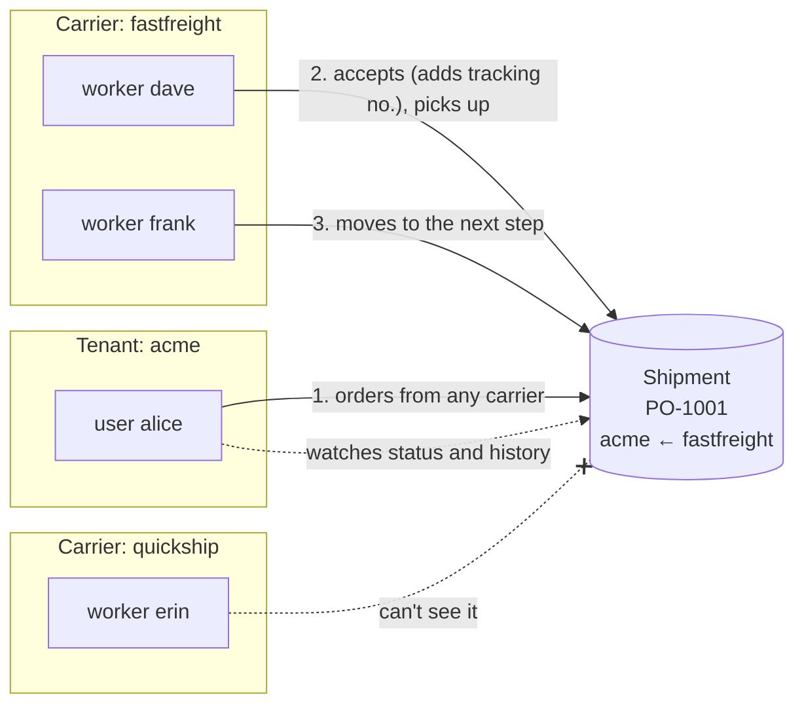
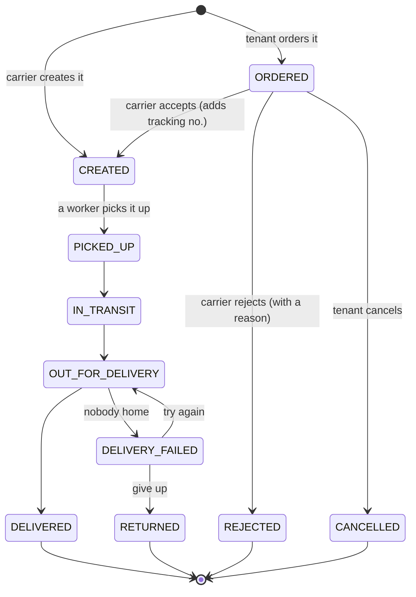
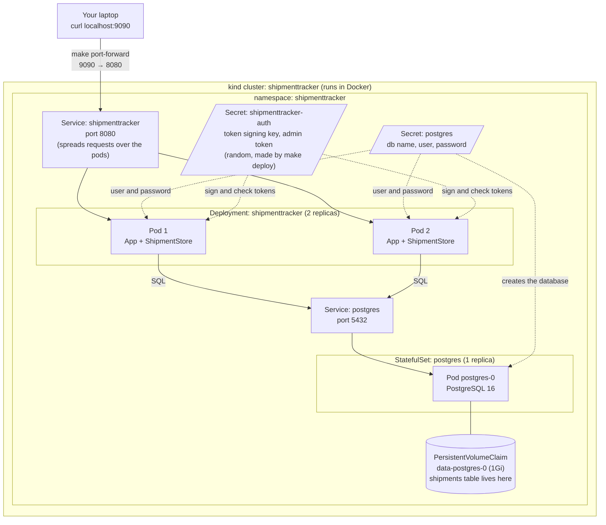
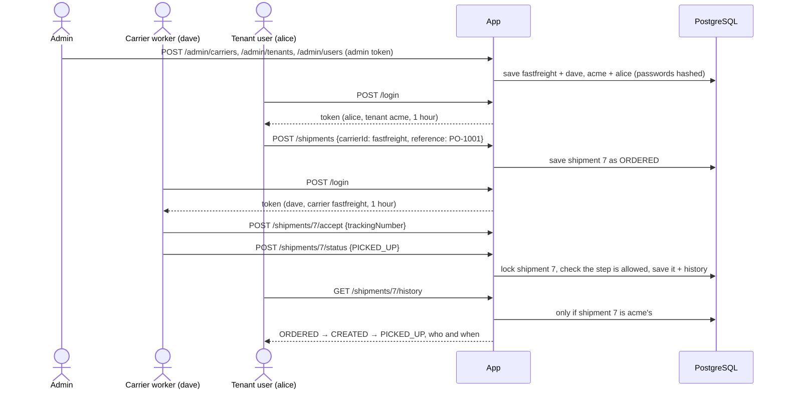
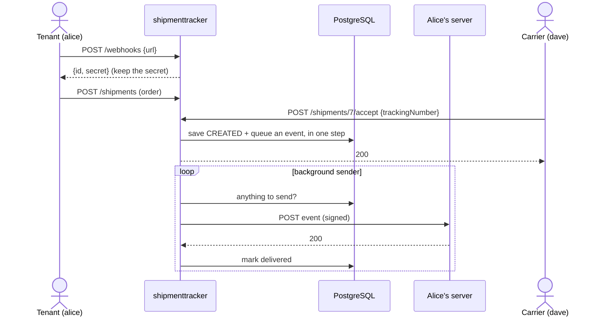

# shipmenttracker

A small web service for ordering and tracking shipments between companies and
carriers.

- **Tenants** (companies, for example `acme`) **order** shipments from any
  carrier they like, then follow every step until delivery. They can cancel
  an order until the carrier accepts it.
- **Carriers** (delivery companies, for example `fastfreight`) **accept or
  reject** those orders, and can also create shipments themselves. Their
  **workers** pick shipments up and move them step by step until delivered.

Everyone signs in. A carrier sees only its own shipments (including orders
placed with it), and a tenant sees only its own orders and the shipments sent
to it.

It is written in Java, stores everything in PostgreSQL, is built with Maven,
and runs in Kubernetes. Everything builds inside Docker, so you only need
Docker, `kind` and `kubectl` on your machine.

## Who does what



## The steps a shipment goes through



Plain text:

```
(tenant orders)                          (carrier creates)
   ORDERED ──carrier accepts──► CREATED ◄───────┘
    │    │                         │
 carrier tenant                    ▼
 rejects cancels               PICKED_UP → IN_TRANSIT → OUT_FOR_DELIVERY → DELIVERED
    ▼    ▼                                                  ↑      │
REJECTED CANCELLED                                          │      ▼
                                                       DELIVERY_FAILED → RETURNED
```

In simple words:

1. **A tenant orders a shipment** from any carrier (`GET /carriers` lists
   them), with its own reference such as a PO number. It starts as `ORDERED`
   and has no tracking number yet.
2. **The carrier answers the order.** It either **accepts** it and gives it a
   tracking number (`CREATED`), or **rejects** it with a reason (`REJECTED`).
   Until then, the tenant may **cancel** it (`CANCELLED`). If the carrier
   accepts and the tenant cancels at the same moment, exactly one wins.
3. **A carrier can also create a shipment directly** for a tenant, with a
   tracking number. It starts at `CREATED`.
4. **A worker picks it up** (`PICKED_UP`). The app remembers who picked it up.
   If several workers try at the same moment, exactly one wins and the others
   are told it's already taken.
5. **Workers move it forward**: `IN_TRANSIT`, then `OUT_FOR_DELIVERY`, then
   `DELIVERED`. Any worker of the same carrier can do the next step.
6. **If delivery fails** (`DELIVERY_FAILED`), it can go out again or be sent
   back (`RETURNED`).
7. **Steps can't be skipped or undone.** Trying gets `409 conflict`, with the
   current status and the steps you're allowed to take next.
8. **Every step is written to the history**: what changed, who did it, when,
   and an optional note (for example "left at front door", or the reason for a
   rejection). Both the carrier and the tenant can read it.

## How it runs in Kubernetes



If the diagram above does not render, here is the same picture in plain text:

```
 Your laptop:  curl localhost:9090
        │
        │ make port-forward (9090 → 8080)
        ▼
┌─ kind cluster "shipmenttracker" ───────────────────────────────────┐
│ ┌─ namespace "shipmenttracker" ──────────────────────────────────┐ │
│ │                                                                │ │
│ │   Secret "shipmenttracker-auth": token signing key, admin token│ │
│ │          (read by both app pods)                               │ │
│ │                                                                │ │
│ │   Service "shipmenttracker" :8080   ← one address for the app  │ │
│ │          │                 │                                   │ │
│ │          ▼                 ▼                                   │ │
│ │   ┌─ Deployment "shipmenttracker" (2 replicas) ─┐              │ │
│ │   │  ┌─────────┐         ┌─────────┐            │              │ │
│ │   │  │  Pod 1  │         │  Pod 2  │            │ ◄─┐          │ │
│ │   │  │   App   │         │   App   │            │   │ password │ │
│ │   │  └────┬────┘         └────┬────┘            │   │          │ │
│ │   └───────┼───────────────────┼─────────────────┘   │          │ │
│ │           └─────────┬─────────┘ SQL                 │          │ │
│ │                     ▼                     Secret "postgres"    │ │
│ │   Service "postgres" :5432                db, user, password   │ │
│ │                     │                               │          │ │
│ │                     ▼                               │          │ │
│ │   ┌─ StatefulSet "postgres" (1 replica) ────────┐   │          │ │
│ │   │  Pod "postgres-0"  (PostgreSQL 16)          │ ◄─┘          │ │
│ │   └──────────────────┬──────────────────────────┘              │ │
│ │                      │                                         │ │
│ │                      ▼                                         │ │
│ │   PersistentVolumeClaim "data-postgres-0" (1Gi)                │ │
│ │   the disk where the shipments table is kept                   │ │
│ └────────────────────────────────────────────────────────────────┘ │
└────────────────────────────────────────────────────────────────────┘
```

In simple words:

1. **kind cluster.** A small Kubernetes that runs inside Docker on your
   laptop. It is called `shipmenttracker` and is separate from any other
   cluster.
2. **Namespace.** A folder inside the cluster that holds everything for this
   project, so it is easy to find and easy to delete.
3. **Port-forward.** Opens a tunnel from your laptop (port 9090) into the
   cluster, so `curl localhost:9090` reaches the app.
4. **Service `shipmenttracker`.** One fixed address for the app. It passes
   each request to one of the app pods.
5. **Deployment, 2 pods.** Two copies of the app run at the same time. Each
   pod has the App (reads the request) and the ShipmentStore (talks to the
   database), plus a webhook sender that runs in the background. If one pod
   stops, Kubernetes starts a new one and the other keeps answering meanwhile.
6. **Service `postgres`.** One fixed address for the database, so the app
   pods can always find it at `postgres:5432`.
7. **StatefulSet, pod `postgres-0`.** Runs PostgreSQL. A StatefulSet is used
   (not a Deployment) because a database needs to keep the same name and the
   same disk every time it restarts.
8. **PersistentVolumeClaim.** The database's disk. Shipments are stored here,
   so they survive when the database pod restarts. The tables are
   `carriers`, `tenants`, `users`, `shipments` (orders too) and `shipment_events` (history).
9. **Secret `postgres`.** Holds the database name, user and password.
   PostgreSQL uses it to set itself up, and the app pods use it to log in.
10. **Secret `shipmenttracker-auth`.** Holds the key the app uses to sign
    login tokens, and the admin token. `make deploy` fills it with random
    values the first time, so they are never written in this repo.

**What happens on a request:** your `curl` goes through the port-forward to
the `shipmenttracker` Service, which hands it to one of the two app pods. That
pod checks your token, sends SQL to the `postgres` Service (always limited to
your carrier or tenant), PostgreSQL reads or writes the tables on its disk,
and the pod sends the answer back to you as JSON.

## How sign-in works



In simple words:

1. **The admin sets things up.** Using the admin token, the admin creates
   carriers and tenants, and their users. Each user belongs to exactly one
   carrier or one tenant. Passwords are never stored as-is, only as a salted
   hash (PBKDF2).
2. **A user signs in.** They send their username and password to `/login` and
   get back a **token**: a short note saying, for example, "this is dave, from
   carrier fastfreight", signed by the app so nobody can change it. It is
   valid for one hour.
3. **The user sends the token with every request**, in the header
   `Authorization: Bearer <token>`.
4. **The app checks the token** (signature and expiry) and reads the carrier
   or tenant from it. It never trusts an organisation sent any other way.
5. **Every database query is limited to that carrier or tenant.** Asking for
   a shipment you may not see gets `404 not found`, the same as if it didn't
   exist, so you can't even tell it's there.

A wrong password and an unknown username get the exact same answer, so nobody
can find out which usernames exist.

Good to know:

- Many requests can be handled at the same time. Each one gets its own
  lightweight Java "virtual thread", and ids are handed out by the database,
  so no two shipments ever get the same id, even across both app copies.
- Status changes lock the shipment's row while they are checked, so two
  people can't both move the same shipment from the same step (two workers
  picking up, or a carrier accepting while the tenant cancels).
- If the database is not ready yet when the app starts, the app keeps retrying
  for about a minute.

## What you can ask it

All bodies are JSON. Missing or bad tokens get `401 unauthorized`.

| Method | Path | Who can call it | What it does |
|--------|------|-----------------|--------------|
| GET  | `/healthz` | anyone | Checks that the app is running |
| POST | `/admin/carriers` | admin token | Adds a carrier: `{"name": "fastfreight"}` |
| POST | `/admin/tenants` | admin token | Adds a tenant: `{"name": "acme"}` |
| POST | `/admin/users` | admin token | Adds a user to one carrier or tenant: `{"carrierId": 1, ...}` or `{"tenantId": 1, ...}`, plus `"username"` and `"password"` (8+ characters) |
| POST | `/login` | anyone | `{"username", "password"}` → `{"token", "tokenType", "expiresIn", "orgType", "orgId"}` |
| GET  | `/carriers` | any signed-in user | Lists carriers to order from: `[{"id", "name"}]` |
| GET  | `/shipments` | carrier or tenant | Carrier: its own shipments and orders. Tenant: its orders and shipments sent to it |
| POST | `/shipments` | tenant user | **Orders** a shipment: `{"carrierId": 1, "reference": "PO-1001", "callbackUrl": "https://..."}` (reference and callbackUrl optional) → `ORDERED` |
| POST | `/shipments` | carrier worker | **Creates** a shipment: `{"trackingNumber": "...", "tenantId": 1, "reference": "..."}` → `CREATED` |
| GET  | `/shipments/{id}` | carrier or tenant | One shipment, if you may see it (otherwise 404) |
| POST | `/shipments/{id}/accept` | carrier worker | Accepts an order: `{"trackingNumber": "...", "note": "optional"}` → `CREATED` |
| POST | `/shipments/{id}/reject` | carrier worker | Rejects an order: `{"reason": "..."}` → `REJECTED` |
| POST | `/shipments/{id}/cancel` | tenant user | Cancels an order that isn't accepted yet: `{"reason": "optional"}` → `CANCELLED` |
| POST | `/shipments/{id}/status` | carrier worker | Next delivery step: `{"status": "PICKED_UP", "note": "optional"}` |
| GET  | `/shipments/{id}/history` | carrier or tenant | Every step so far: status, who, note, when |
| POST | `/webhooks` | carrier or tenant | Registers a URL to be told about every change: `{"url": "https://..."}` → includes the signing `secret` (shown only once) |
| GET  | `/webhooks` | carrier or tenant | Lists your webhooks (without secrets) |
| DELETE | `/webhooks/{id}` | carrier or tenant | Removes a webhook; anything not yet sent to it is dropped |
| GET  | `/webhooks/{id}/deliveries` | carrier or tenant | The latest 50 deliveries: status, tries, last error |
| POST | `/webhooks/callback-secret` | tenant user | Makes (or replaces) the one secret that signs all your per-order callbacks → `{"secret"}` (shown only once) |

A move that isn't allowed from the current step gets `409 conflict`. Calling
an endpoint meant for the other side (a tenant accepting, a carrier
cancelling) gets `403 forbidden`, or `404` if it's a shipment you can't see at
all.

## Webhooks: getting told when something changes

Instead of asking again and again, a tenant (or carrier) can register a
webhook: a URL of theirs that shipmenttracker calls every time one of their
shipments changes. This is how a tenant learns the tracking number as soon as
the carrier accepts its order.



**What gets sent.** A `POST` with a JSON body like this, for every change
(including when an order is placed):

```json
{
  "id": "0b6c2a8e-3f4d-4a3e-9d0f-2c1f5e7a9b10",
  "type": "shipment.status_changed",
  "occurredAt": "2026-11-16T15:04:05.123Z",
  "previousStatus": "ORDERED",
  "status": "CREATED",
  "changedBy": "dave",
  "note": null,
  "shipment": {
    "id": "7", "carrierId": 1, "tenantId": 1,
    "trackingNumber": "FF123456789", "reference": "PO-1001",
    "status": "CREATED", "pickedUpBy": null, "updatedAt": "2026-11-16T15:04:05.123Z"
  }
}
```

Both the tenant and the carrier of the shipment get it, if they have
webhooks. So does the order's own callback URL, if it has one (see below).
Nobody else does.

**Checking it really came from shipmenttracker.** Each request has a header

```
X-Shipmenttracker-Signature: t=1794841445,v1=5f2c...e9
```

where `v1` is HMAC-SHA256 of `"<t>.<raw body>"` using your webhook's
`secret`. Recompute it and compare; also reject old `t` values (say, older
than 5 minutes) so a captured request can't be replayed later. In Python:

```python
import hashlib, hmac, time

def is_genuine(secret: str, header: str, body: bytes) -> bool:
    parts = dict(p.split("=", 1) for p in header.split(","))
    t, sent = parts["t"], parts["v1"]
    expected = hmac.new(secret.encode(), f"{t}.".encode() + body, hashlib.sha256).hexdigest()
    return hmac.compare_digest(expected, sent) and abs(time.time() - int(t)) < 300
```

In simple words:

1. **Nothing is lost.** The event is saved in the same database step as the
   change itself. If the change is saved, so is the event, even if the app
   restarts right after.
2. **It keeps trying.** If your server is down or answers with an error, the
   app tries again after 2s, 4s, 8s, ... (8 tries, about 4 minutes in all).
   After that the delivery is marked `FAILED`; you can see it under
   `/webhooks/{id}/deliveries`.
3. **Events arrive in order.** Each webhook gets its events one at a time, in
   the order they happened. If one keeps failing, the later ones wait for it.
4. **Rarely, an event can arrive twice** (for example, if the app restarts
   just after sending). Each event has an `id` (also in the
   `X-Shipmenttracker-Event-Id` header), so ignore ids you've already seen.
5. **Answer quickly** with any `2xx`. The app waits at most 10 seconds and
   doesn't follow redirects.

**Safety.** The app calls these URLs from inside the cluster, so by default it
only accepts `https://` URLs that point to public internet addresses. URLs
for `localhost`, private networks (`10.x`, `192.168.x`, ...), cluster
addresses or cloud metadata (`169.254.169.254`) are refused, both when you
register and again before each send. Setting `WEBHOOK_ALLOW_PRIVATE=true`
turns this off, for local development only.

### A callback URL for one order

A tenant can also give a URL **when placing an order**. That URL hears about
that one order only, from the moment it's placed until it's finished. This is
handy when each order comes from a different system, or when the tenant's
system just wants to be told "this PO now has a tracking number".

All of a tenant's per-order callbacks are signed with **one shared secret**,
so its system only has to keep one secret, not one per order.

```bash
# Once: make the tenant's callback secret (keep it; it's shown only now)
curl -s -X POST $API/webhooks/callback-secret -H "$(auth $ALICE)"
# → {"secret": "whsec_...", "createdAt": "..."}

# Each order: give a callback URL
curl -s -X POST $API/shipments -H "$(auth $ALICE)" \
  -d '{"carrierId": 1, "reference": "PO-1001", "callbackUrl": "https://erp.acme.com/hooks/po-1001"}'
# → {"id": "7", "status": "ORDERED", ..., "callback": {"webhookId": 12, "url": "https://erp.acme.com/hooks/po-1001"}}
```

In simple words:

1. **Make the secret once** with `POST /webhooks/callback-secret`. Calling it
   again makes a new one and the old one stops working; anything still
   waiting to be sent is signed with the new one.
2. **Add `callbackUrl` to any order.** It's checked with the same safety rules
   as other webhooks. If the URL isn't allowed, or there's no secret yet, the
   order isn't placed at all (`400` or `409`), so you never end up with an
   order whose callback silently doesn't work.
3. **The callback gets the same events, signed the same way**, just with the
   shared callback secret instead of a webhook's own secret. It gets the
   `ORDERED` event too, because it's saved together with the order.
4. **The carrier never sees the callback URL.**
5. **It cleans itself up.** Once the order is finished (`DELIVERED`,
   `RETURNED`, `REJECTED` or `CANCELLED`) and its last event has been sent,
   the callback is removed after a day. Until then it shows in
   `GET /webhooks` (with its `shipmentId`), and you can remove it early with
   `DELETE /webhooks/{id}`. Per-order callbacks don't count towards the limit
   of 10 webhooks.

## Run it in Kubernetes

```bash
make deploy        # build the image, create the kind cluster, deploy app + Postgres
make port-forward  # make the API reachable at http://localhost:9090
```

Then, in another terminal:

```bash
API=localhost:9090
ADMIN=$(make -s admin-token)
auth() { echo "Authorization: Bearer $1"; }
login() { curl -s -X POST $API/login -d "{\"username\": \"$1\", \"password\": \"$2\"}" \
  | sed -E 's/.*"token":"([^"]+)".*/\1/'; }

# Admin: a carrier with a worker, a tenant with a user
curl -s -X POST $API/admin/carriers -H "$(auth $ADMIN)" -d '{"name": "fastfreight"}'
curl -s -X POST $API/admin/tenants  -H "$(auth $ADMIN)" -d '{"name": "acme"}'
curl -s -X POST $API/admin/users -H "$(auth $ADMIN)" \
  -d '{"carrierId": 1, "username": "dave", "password": "change-me-please"}'
curl -s -X POST $API/admin/users -H "$(auth $ADMIN)" \
  -d '{"tenantId": 1, "username": "alice", "password": "change-me-please"}'

# Tenant user: see the carriers, order from one
ALICE=$(login alice change-me-please)
curl -s $API/carriers -H "$(auth $ALICE)"
curl -s -X POST $API/shipments -H "$(auth $ALICE)" -d '{"carrierId": 1, "reference": "PO-1001"}'

# Carrier worker: accept the order with a tracking number, then move it along
DAVE=$(login dave change-me-please)
curl -s -X POST $API/shipments/1/accept -H "$(auth $DAVE)" -d '{"trackingNumber": "FF123456789"}'
curl -s -X POST $API/shipments/1/status -H "$(auth $DAVE)" -d '{"status": "PICKED_UP"}'
curl -s -X POST $API/shipments/1/status -H "$(auth $DAVE)" -d '{"status": "IN_TRANSIT"}'

# Tenant user: follow it
curl -s $API/shipments/1         -H "$(auth $ALICE)"
curl -s $API/shipments/1/history -H "$(auth $ALICE)"
```

Other commands:

```bash
make status        # show pods, services and the database disk
make admin-token   # print the admin token (keep it private)
make undeploy      # remove the app and database (the cluster stays)
make cluster-down  # delete the whole kind cluster
```

The cluster is a separate kind cluster called `shipmenttracker`. All commands
use the `kind-shipmenttracker` context, and creating it leaves your current
kubectl context unchanged.

## Tests

```bash
make test          # start a throwaway Postgres on port 5433, run the tests
make test-db-down  # remove that throwaway Postgres
```

## Where things are

| File | What it is |
|------|------------|
| `src/main/java/shipmenttracker/App.java` | The front door: starts the server, checks tokens, handles requests |
| `src/main/java/shipmenttracker/ShipmentStatus.java` | The steps, which step may follow which, and who (carrier or tenant) may make each move |
| `src/main/java/shipmenttracker/ShipmentStore.java` | Reads and writes shipments and their history, always for one carrier or tenant |
| `src/main/java/shipmenttracker/AccountStore.java` | Reads and writes carriers, tenants and users |
| `src/main/java/shipmenttracker/Tokens.java` | Makes and checks the signed login tokens (JWT, HS256) |
| `src/main/java/shipmenttracker/Passwords.java` | Hashes and checks passwords (PBKDF2) |
| `src/main/java/shipmenttracker/Database.java` | The connection pool and the tables |
| `src/main/java/shipmenttracker/Shipment.java` | What one shipment and one history step look like |
| `src/main/java/shipmenttracker/WebhookStore.java` | Webhook registrations and the queue of events to send (the "outbox") |
| `src/main/java/shipmenttracker/WebhookDispatcher.java` | The background sender: signs, sends, retries |
| `src/main/java/shipmenttracker/WebhookUrls.java` | Checks webhook URLs are safe to call |
| `src/main/java/shipmenttracker/Views.java` | The JSON shape of a shipment, shared by the API and webhooks |
| `src/test/java/shipmenttracker/AppTest.java` | A carrier creates a shipment; carrier and tenant read it |
| `src/test/java/shipmenttracker/OrderTest.java` | Ordering from any carrier; accept, reject, cancel; the accept-vs-cancel race |
| `src/test/java/shipmenttracker/StatusTest.java` | The delivery steps, failed delivery, history, and who may change status |
| `src/test/java/shipmenttracker/AuthTest.java` | Who sees what, bad and forged tokens, login and admin checks |
| `src/test/java/shipmenttracker/ConcurrencyTest.java` | 500 parallel creates; 20 workers racing to pick up one shipment |
| `src/test/java/shipmenttracker/WebhookTest.java` | Webhook payloads, signatures, order, retries, giving up, who hears what, URL safety |
| `src/test/java/shipmenttracker/CallbackTest.java` | Per-order callbacks: shared secret, rotation, only-this-order, clean-up, bad URLs |
| `k8s/app.yaml` | Kubernetes namespace, app Deployment and Service (reads the auth Secret) |
| `k8s/postgres.yaml` | PostgreSQL StatefulSet, Service, disk and (dev-only) password |
| `kind-config.yaml` | The local kind cluster |
| `Dockerfile` | Builds the app image (Maven runs inside Docker) |
| `pom.xml` | Maven build: PostgreSQL driver, connection pool, JWT, Jackson, JUnit |
| `Makefile` | Shortcuts for test, deploy and the rest |

## Settings

| Variable | Default | Meaning |
|----------|---------|---------|
| `PORT` | `8080` | Port the app listens on |
| `DATABASE_URL` | `jdbc:postgresql://localhost:5433/shipments` | Where the database is |
| `DATABASE_USER` | `shipments` | Database user |
| `DATABASE_PASSWORD` | `shipments` | Database password (dev only) |
| `JWT_SECRET` | required | Key for signing login tokens (32+ bytes) |
| `ADMIN_TOKEN` | required | Token for `/admin/*` (32+ characters) |
| `TOKEN_TTL_MINUTES` | `60` | How long a login token is valid |
| `WEBHOOK_MAX_ATTEMPTS` | `8` | Tries per webhook delivery before giving up |
| `WEBHOOK_ALLOW_PRIVATE` | `false` | Allow `http://` and private/internal webhook URLs. **Local development only** |

## Ideas for next steps

- Let a tenant say which carriers may send to it (today any carrier can address any tenant).
- Webhooks: rotate a secret without downtime, store secrets encrypted, and a "send a test event" button.
- Order details: pickup and delivery addresses, parcel size and weight, a price quote before accepting.
- Limit login attempts, so passwords can't be guessed quickly.
- A way to sign out early or block a user's tokens before they expire.
- Roles (for example, a carrier dispatcher who creates shipments while drivers only move them).
- Move the database password to a real secret store.
- Add a readiness check that also checks the database.
